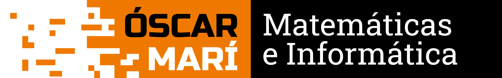

<p align="center">
  
</p>

<p align="center">
  <strong>Centro especializado en ciencias y tecnología</strong><br>
  Santa Eulalia del Río · Ibiza
</p>

<p align="center">
  <a href="https://oscarmari.es"></a>
  <a href="https://www.instagram.com/oscarmari_mi/"></a>
  <a href="https://wa.me/34693291523"></a>
</p>

---

## Quiénes somos

Somos un centro cercano y no masificado, centrado en ciencias y tecnología. Trabajamos en grupos pequeños, con atención personalizada y seguimiento de cada alumno. El objetivo no es solo aprobar: es crear hábitos, autonomía y una base sólida.

Lo dirige Óscar Marí, profesor y programador, con experiencia previa en desarrollo de videojuegos.

## Programación y tecnología

| Curso | Edad | Nivel |
|---|---|---|
| Programación con **Scratch** | 8 a 11 años | Iniciación |
| Programación con **Python** | 12 a 17 años | Iniciación |
| Mecanografía | Todas las edades | — |
| Informática básica | Todas las edades | — |

- Grupos de hasta 6 alumnos.
- El centro presta los ordenadores: no hace falta traer el tuyo.

```python
# Así empieza todo
nombre = input("¿Cómo te llamas? ")
print(f"Hola, {nombre}. Vamos a programar.")
```

## Refuerzo académico

Matemáticas, física, química y técnicas de estudio.

- ESO y Bachillerato, incluida la preparación de la PAU.
- Pruebas de acceso a FP (grado medio y superior) y a la universidad (mayores de 25, 40 y 45).
- Adultos que retoman los estudios: clases particulares, presenciales u online.
- Grupos reducidos de hasta 5 alumnos, cada uno con su asignatura y su ritmo.

## Próximamente

Programación como refuerzo para ESO y Bachillerato, y robótica.

## Contacto

- **WhatsApp:** [693 29 15 23](https://wa.me/34693291523) (vía preferente)
- **Web:** [oscarmari.es](https://oscarmari.es)
- **Instagram:** [@oscarmari_mi](https://www.instagram.com/oscarmari_mi/)
- **Dirección:** C/ Pare Vicent Costa, 9 (Ed. Ibicentro), Santa Eulalia del Río · [Ver en el mapa](https://maps.app.goo.gl/ocjYRVDEyqxzAWvc6)
- **Horario de clases:** lunes a jueves de 15:30 a 20:30 · viernes de 16:00 a 20:30
